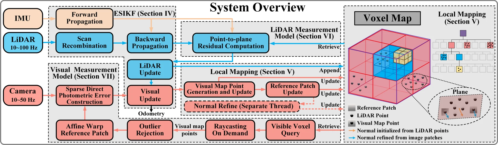
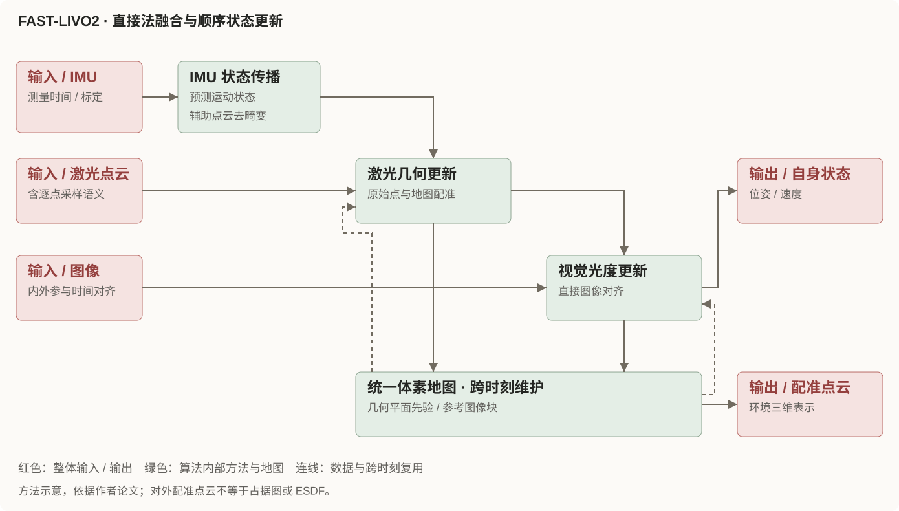
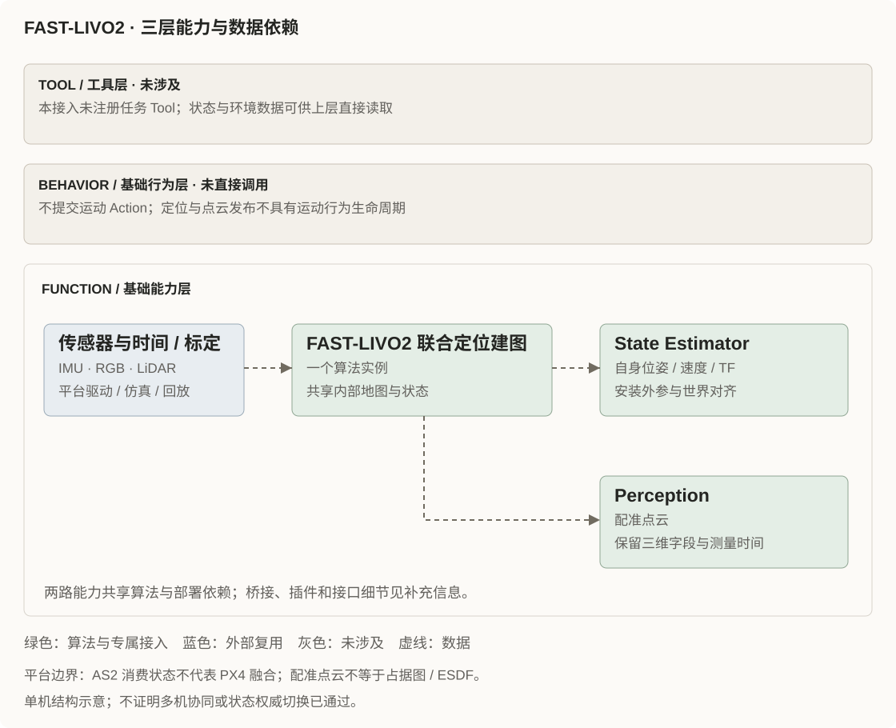

## 算法核心

<figure class="method-card">

<figcaption><h3>顺序更新，共享地图</h3>
几何与光度测量在同一状态估计中顺序更新；地图保存两类观测信息。完整原图见来源。
</figcaption>
</figure>

算法方法依据[作者论文](https://arxiv.org/abs/2408.14035)：地图中的激光平面先验辅助图像对齐，参考图像块随新图像对齐更新。本图展示完整 LIVO 模式。图中反馈表示跨时刻的地图复用，不代表两个独立定位器。内部统一地图与本项目对外发布的配准点云应分别理解。

## 在 Aerohub 中如何接入

- **Tool**：本接入未注册任务 Tool，状态和点云可由上层直接读取。
- **Behavior**：无直接运动 Action 调用，不将定位输出包装成飞行动作。
- **Function**：一个联合算法实例，经共享输出桥分别接入 State Estimator 与 Perception；两路能力共用算法和部署依赖。

联合算法只保留一个实例。配准点云不自动等于占据图或 ESDF，AS2 接入也不代表 PX4 已融合外部定位。

## 案例

<!-- 暂留空，等待可公开核查的案例材料。 -->

## 补充信息

接入细节与验证记录

Demo 画面来自[作者公开素材](https://i.ytimg.com/vi/6dF2DzgbtlY/maxresdefault.jpg)，保留未修改的本地副本，用于链接官方演示；素材来源见上方作者仓库，演示效果不计入本项目验收。

### 三层接入关系

本项目的实际覆盖集中在 **Function 层**。图中保留 Tool 与 Behavior 两层并说明未绑定，避免将输出被上层读取误写成算法已经提供了任务工具或运动执行。联合算法只保留一个实例，状态与点云两路输出共享算法和部署依赖。

| 架构层 | 实际接入 | 边界 |
| --- | --- | --- |
| Tool | 未注册任务 Tool | 数据可供上层订阅，不宣称已接入某个 Navigation Tool |
| Behavior | 无直接运动 Action 调用 | 状态发布不具有运动 Behavior 生命周期 |
| Function：State Estimator | 原生 ROS 2 FAST-LIVO2 输出与 AS2 插件 | 适配自身位姿、速度及 TF，保留统一状态接口 |
| Function：Perception | 原生 ROS 2 配准点云 Adapter | 保留三维点云，不自动产生占据图或 ESDF |
| Function：传感器输入 | ROS 2 IMU、图像与 AirSim LiDAR Adapter | AirSim 不提供 LiDAR 逐点时间，当前按瞬时扫描处理；传感器模型和标定仍按部署核查 |

### Function：一个算法进程，两类能力

FAST-LIVO2 使用锁定的原生 ROS 2 Humble 实现。算法、输入/输出 Adapter 与 AS2 插件编译进同一个自包含组件镜像，不依赖 ROS 1、Proxy 或宿主 workspace。位姿与速度回答“自身在哪里、如何运动”，配准点云回答“周围有什么”；职责分开，不要求把联合算法拆为两个独立估计器。

| 模块 | 输入 → 输出 | 实现与消费者 |
| --- | --- | --- |
| 联合算法 | ROS 2 IMU、图像、Livox 消息 → 状态与配准点云 | `src/basic_function/state_estimator/fast_livo2/ros2_upstream/`，保留一份锁定算法源码 |
| 输入/输出 Adapter | AirSim `PointCloud2` → Livox 消息；算法状态/点云 → AeroHub namespaced 接口 | `src/basic_function/state_estimator/fast_livo2/ros2_adapter/`；保留测量时间和点云原生字段 |
| AS2 State Estimator 插件 | 算法里程计、安装外参与世界对齐 → 自身位姿、速度、TF | `src/basic_function/state_estimator/fast_livo2/plugin/`；统一输出供控制、Behavior 与上层消费者读取 |
| Perception 接口 | 配准点云 → namespaced 环境点云 | `src/basic_function/perception/fast_livo2/` 描述接口，与状态接入共享算法和依赖；不是第二个独立算法进程 |

### 状态、点云接口与共享部署

本组件**无直接运动 Behavior 调用**，不创建 Planner 或运动 Behavior。状态经 `/<namespace>/self_localization/pose`、`self_localization/twist` 与 TF 提供；点云经 `/<namespace>/perception/fast_livo2/registered_points` 提供。

同一架飞机的主状态与 TF 应有明确发布权；示例不自动替换多机现有定位源。AS2 消费 FAST-LIVO2 状态，不代表 PX4 已融合外部定位。配准点云也不等于占据图、ESDF 或可直接消费的完整导航地图。

状态与环境接口共用同一个原生 ROS 2 算法实例；仅停止某一路消费者不等于停止算法，重置算法时需处理两路消费者的局部世界变化。核查依据为 `src/basic_function/state_estimator/fast_livo2/README.md`、`ros2_adapter/`、`plugin/src/plugin.cpp` 以及 `src/basic_function/perception/fast_livo2/README.md`。图中没有把它们拆成两个可独立启停的估计器。

### 已验证范围与接入缺口

当前自包含镜像已完成原生 Humble 编译和无源码挂载的进程冒烟验证，算法及三个 Adapter 节点能够从镜像内部 install tree 启动。这只证明构建和基础入口可用；新的有屏 AirSim + PX4 SITL shadow、authority 与故障矩阵尚未执行完，因此定位精度和权威状态源切换仍未通过现行成功标准。

AirSim 传感器 Adapter 将 ROS 2 `PointCloud2` 转换为算法使用的 Livox ROS 2 消息。AirSim 1.8.1 缺少逐点时间，Adapter 使用零偏移并按瞬时扫描处理；不能把补齐字段理解为恢复了真实旋转扫描时间。

旧 ROS 1/Proxy 验收记录只作为历史结论，不能证明当前自包含 Humble 镜像通过。真实数据集、权威仿真飞行和真机验收仍未通过，组件保持 `migration-in-progress`。

### 本次核查与来源

本页现以 `ros2_upstream/`、ROS 2 Adapter、AS2 插件和自包含组件镜像为当前实现依据。算法核心图仍按公开方法绘制，并链接作者论文供对照；完整有屏验收完成前不把镜像冒烟结果扩展为算法精度结论。

- [状态估计组件说明](https://github.com/Air-Suck/aerohub/blob/main/src/basic_function/state_estimator/fast_livo2/README.md)
- [环境输出接口说明](https://github.com/Air-Suck/aerohub/blob/main/src/basic_function/perception/fast_livo2/README.md)
- [作者论文：FAST-LIVO2](https://arxiv.org/abs/2408.14035)

以上仓库链接用于定位文档；本页同步的是 2026-11-12 本地工作区内容，不将可变的 main 链接当成公开验收证据。单机接口示例不证明多机共享地图、全局对齐或协同定位已实现；多机部署需要每机独立实例、namespace 与状态发布权配置。

